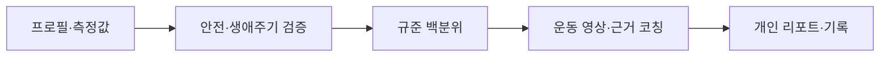
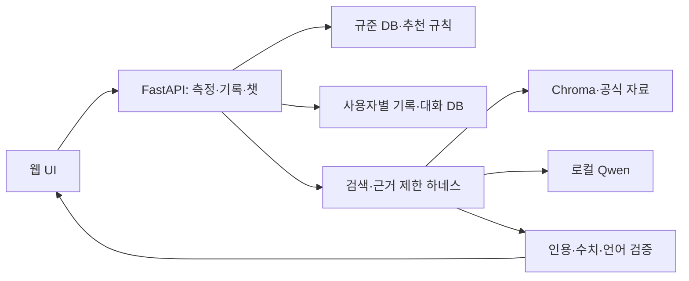
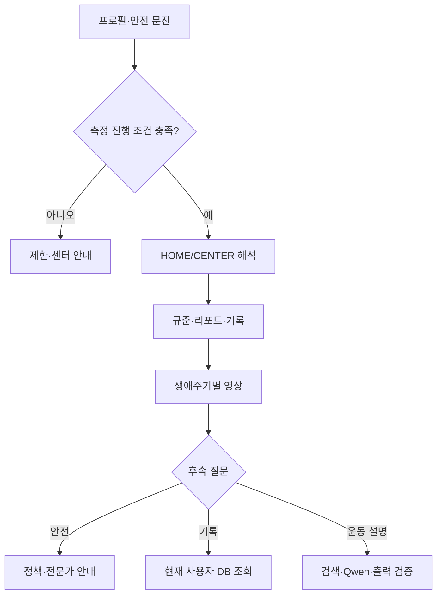

# AI 체력 코치 - 측정부터 근거 기반 운동 안내까지

국민체력100 측정값을 또래 기준과 비교하고, 부족한 체력요인에 맞는 공식 운동 영상과 코칭으로 연결하는 4인 팀 프로젝트입니다. **제 담당은 Backend·DB, 사용자 기록·세션 분리, 프론트·RAG 연결과 Windows 실행 패키지였습니다.**

**현재 범위:** 공개 서비스 코드·소형 규준 DB·테스트·화면 자료입니다. Qwen 모델·Chroma 인덱스·RAG 원문 DB·사용자 DB와 공식 검수 골드셋은 별도입니다.

**프로젝트 형태:** 움직임연구소 4인 팀 프로젝트 · **김민 담당:** 백엔드·사용자 DB·Qwen/RAG 서비스 연동·Windows 실행 패키지. [개인 기여와 팀 역할](#기여와-ai-활용)에서 작업 범위와 근거를 확인할 수 있습니다.



[빠른 실행](#빠른-실행) · [결과](#결과) · [문제](#문제정의) · [구조](#아키텍처) · [상세 흐름](#상세-워크플로우) · [데이터](#데이터) · [시도](#시도와-개선) · [평가](#평가와-재현) · [한계](#한계) · [기여](#기여와-ai-활용)

## 빠른 실행

Python 3.10~3.12를 기준으로 개발했습니다. 저장소 루트에서 모델·DB·서버를 띄우지 않는 **코칭 계약 테스트**부터 확인할 수 있습니다.

```powershell
python -m pip install -r apps/api/requirements-dev.txt
$env:PYTHONPATH = (Resolve-Path 'apps/api/src').Path
python -m pytest -q apps/api/tests/test_coaching_interpretation.py
```

2026-11-15에는 **10 tests passed, 8 subtests passed**였습니다. Mock 모델의 출력과 코드의 근거·해석 구분을 확인하며 실제 Qwen·Chroma 검색 점수가 아닙니다. [테스트](apps/api/tests/test_coaching_interpretation.py), [이번 검증 기록](docs/README_VERIFICATION.md)

전체 서비스는 `apps/api/requirements.txt`, Qwen GGUF, 임베딩 모델·Chroma·RAG DB와 필요한 런타임 DB를 준비해야 합니다. 웹 진입점은 `fitness_web_server:app`이며 `apps/api/src`를 Python 경로로 사용합니다. 패키지용 시작 스크립트는 별도 배포 폴더 구조를 가정하므로 clone에 그대로 적용되는 원클릭 설치로 보지 않습니다. [외부 자산·평가 실행](evaluation/README.md), [데이터 생성](data/README.md), [원래 실행 기록](README_HISTORY.md#실행-환경)

## 결과

| 입력·조건 | 출력 | 근거 |
|---|---|---|
| HOME 측정 | 오차를 반영한 백분위 구간·리포트 | [측정 API](apps/api/src/fitness_mvp.py) |
| CENTER 측정 | 점 백분위와 사용자별 기록 | [규준 조회](apps/api/src/center_percentile.py) |
| 부족 요인·후속 질문 | 생애주기에 맞는 공식 영상·근거 설명 | [추천·코칭 코드](apps/api/src/fitness_mvp.py) |


기존 시연 화면이며 의료적 진단·공식 인증등급이나 장기 운동 효과를 뜻하지 않습니다. [전체 서비스·검증 설명](docs/PORTFOLIO.md)

## 문제정의

체력측정 결과를 받아도 어떤 운동을 해야 하는지 연결되지 않았습니다. 측정 원시 기록, 추천 규칙, 공식 영상이 서로 다른 구조였고, 자가측정과 센터 측정은 같은 정확도로 표현할 수 없었습니다. 연령이 맞지 않는 영상이나 다른 사용자의 기록이 섞이면 개인화라는 설명도 성립하지 않았습니다.

## 아키텍처



| 구성·책임 | 실제 코드 | 별도 준비할 것 |
|---|---|---|
| 안전·인증·측정·기록·추천 | [fitness_mvp.py](apps/api/src/fitness_mvp.py) | 사용자 DB는 공개하지 않음 |
| 규준·백분위·생애주기 규칙 | [center_percentile.py](apps/api/src/center_percentile.py), [age_bmi_recommendations.py](apps/api/src/age_bmi_recommendations.py) | 공개 소형 규준 DB와 데이터 역할 구분 |
| 웹·검색·모델 연결 | [fitness_web_server.py](apps/api/src/fitness_web_server.py), [하네스](apps/api/src/qwen3_grounded_harness.py) | 모델·RAG DB·Chroma 인덱스 |
| 리포트·영상·대화 UI | [apps/web](apps/web) | API 응답과 같은 사용자 맥락 유지 |

## 상세 워크플로우



| 단계 | 실제 처리와 결과 | 확인할 코드·문서 |
|---|---|---|
| 1. 사용자와 안전 | 로그인 토큰과 사용자 정보를 확인합니다. 문진 결과와 연령·생애주기 조건을 검사하며, 정책에 맞지 않는 자가측정을 진행시키지 않습니다. | [fitness_mvp: login·screening·인증](apps/api/src/fitness_mvp.py) |
| 2. 측정 해석 | 측정 출처, 나이, 생애주기와 필수 입력을 검사합니다. 성별·연령대 규준으로 계산하고 HOME은 오차를 반영한 구간, CENTER는 점 백분위로 구분합니다. | [_evaluate·evaluate](apps/api/src/fitness_mvp.py), [규준 조회](apps/api/src/center_percentile.py) |
| 3. 기록과 리포트 | 인증된 사용자의 기록을 저장·조회하고 화면은 같은 응답으로 표와 레이더를 표시합니다. 입력하지 않은 측정값은 추정하지 않습니다. 규준 표본이 부족하면 명시된 인접 연령 합산 규준을 사용하거나 표본 부족 상태를 반환합니다. | [기록 API](apps/api/src/fitness_mvp.py), [웹 코드](apps/web) |
| 4. 운동 연결 | 생애주기에 맞는 영상 후보부터 남기고 측정항목·백분위에 따라 단계와 준비·본·마무리 영상을 선택합니다. 영상 길이를 실제 권장 운동시간과 혼동하지 않습니다. | [recommendation-videos](apps/api/src/fitness_mvp.py), [추천 규칙](apps/api/src/age_bmi_recommendations.py) |
| 5. 코칭 분기 | 통증 등 안전 질문은 정책 응답으로 처리합니다. 개인 기록 조회·비교는 사용자 DB를 우선하며, 필요한 운동 설명은 검색 하네스와 모델에 연결합니다. | [fitness_chat](apps/api/src/fitness_mvp.py), [대화 정책](apps/api/src/coach_dialogue.py), [대화 하네스](apps/api/src/fitness_chat_harness_v2.py) |
| 6. 생성 검증 | 운동명·설명·숫자·인용을 근거와 대조하고 잘못된 필드의 보완·대체 응답을 처리합니다. 전체 응답을 자유 생성에 맡기지 않습니다. | [근거 제한 하네스](apps/api/src/qwen3_grounded_harness.py) |

### 재질문·인증 만료·프로필 전환

나이와 생애주기가 충돌하거나 계산에 필요한 체중 등이 없으면 값을 만들어 진행하지 않습니다. 기록이 없으면 비교 불가를 안내합니다. 만료 토큰은 401로 처리하고 연결된 대화를 정리합니다. 인증 대화는 서버에서 토큰·사용자·대화 ID에 따라 읽어 브라우저가 보낸 다른 사람의 과거 대화를 그대로 신뢰하지 않습니다. 프런트 요청에는 시간 제한과 취소 처리를 적용했습니다. 세부 동작은 [백엔드 작업일지](apps/api/KIMMIN_BACKEND_WORKLOG.md)에 남겼습니다.

## 데이터

| 데이터 | 역할 | 공개·해석 범위 |
|---|---|---|
| 국민체력100 측정·처방 데이터 | 성별·연령대별 기준과 추천 | 원본 대용량 자료 제외, 공개 규준 DB는 포함 |
| HOME 오차·측정 규칙 | 자가측정 백분위 구간 | 센터 측정의 정밀도와 구분 |
| 공식 영상 메타데이터 | 생애주기·요인·장소·운동 단계 연결 | 영상 길이와 개인 권장 운동량은 다름 |
| RAG DB·Chroma·Qwen | 근거 검색·코칭 | 대용량 자산·모델 별도 |
| 사용자 측정·문진·대화 | 개인 기록과 비교 | 저장소에서 제외, 소유권·세션 분리 |

[데이터 범위·재현·이용 조건](data/README.md) · [팀 데이터·RAG 기여](docs/TEAM_ROLES.md)

## 시도와 개선

| 겪은 문제 | 선택한 해결 방법 | 확인과 남은 한계 |
|---|---|---|
| 어르신에게 성인 영상이 추천됨 | 연령대 가산점 대신 생애주기 필터를 먼저 적용 | 나이·생애주기 일치와 영상 선택을 계약 테스트·API로 확인 |
| HOME·CENTER가 같은 확정값처럼 보임 | 출처별 구간·점 백분위를 분리하고 프론트와 API를 대조 | 의료적 정확도나 공식 인증등급을 발급하는 기능은 아님 |
| 사용자 전환 뒤 기록·대화 혼합 위험 | 사용자별 기록 소유권, 서버 대화 범위, 토큰 만료·정리 | 기존 사용자 분리 계약 검증이며 모든 공격을 포함한 보안 감사와 다름 |
| 같은 26분 영상이 세 번 반복됨 | 행 수 대신 고유 URL을 대조하고 동작별 짧은 공식 영상과 전체 프로그램을 구분 | 영상 길이와 실제 운동량 표시를 완전히 연결하는 후속 작업이 남음 |
| 로컬 서비스·모델을 따로 실행하기 어려움 | 시작·종료 스크립트와 필수 파일 점검을 묶고 재실행 확인 | 대용량 모델과 인덱스를 별도로 준비해야 함 |

## 평가와 재현

| 검증 종류 | 결과·조건 | 근거·재현 | 한계 |
|---|---|---|---|
| 기존 팀 서버 평가 | HTTP·경로 145/145, Chroma 대상 80/80, R5 80/80, R8 65/65, R11 6/6 | [기존 평가 설명](docs/PORTFOLIO.md), [실행기·필수 자산](evaluation/README.md) | 원 응답·공식 골드셋 별도, 이번에 재수집하지 않음 |
| 기존 3인 검토 | 12/12 다수결, 10건 만장일치 | [기존 정성 결과](docs/PORTFOLIO.md) | 소표본·당시 조건, 장기 사용성 아님 |
| 코칭 계약 재실행 | 2026-11-15: 10 tests + 8 subtests 통과 | [실제 테스트·실행 기록](docs/README_VERIFICATION.md) | Mock 모델 사용, 실제 검색·Qwen 실행 아님 |
| 전체 회귀 실행 시도 | `python -m pytest -q apps/api/tests` | 같은 작업의 55초 제한에서 완료 못 함 | 통과로 표시하지 않음 |

각 분모와 실행 범위를 합쳐 하나의 정확도로 만들지 않습니다. 공식 골드셋·외부 DB·모델이 없으면 전체 평가를 재현할 수 없습니다. RAGAS와 실서버 비교에는 [별도 전제](evaluation/README.md)가 필요합니다.

## 한계

| 한계 | 영향 | 현재 처리·다음 확인 |
|---|---|---|
| 모델·인덱스·공식 평가 자산 별도 | 공개본만으로 모든 기존 수치 재현 불가 | 자산 공급·검수 조건 명시 |
| 자가측정 오차·작은 규준 표본 | 과도한 정밀도·비교 오해 가능 | HOME/CENTER 분리, 표본 부족 표시 |
| 건강·통증 질문 | 의료 판단으로 오해할 위험 | 안전 정책과 전문가 상담 안내 |
| 사용자·프로필 전환 | 기록·대화 혼합 위험 | 서버 소유권·토큰·대화 범위 검증. 종합 보안 감사와 구분 |
| 공공데이터 갱신·장기 사용 | 오래된 규칙·효과 미확인 | 재생성 자동화와 장기 검증이 남음 |

## 기여와 AI 활용

### 팀 전체와 개인 담당

움직임연구소 **4인 팀 프로젝트**입니다. 측정→백분위 비교→운동 추천→대화로 이어지는 서비스와 평가 결과는 팀 전체 산출물입니다.

| 구성원 | 팀 내 주요 역할 |
|---|---|
| 이다겸 | PM, 데이터 분석·규준과 홈 측정 기준 설계, 평가 운영, GCP 배포·서빙 |
| 서한호 | 데이터·RAG 구축, AI 모델 서버 |
| 김수경 | 프론트엔드·UX |
| **김민(본인)** | **백엔드·사용자 DB, Qwen/RAG 서비스 연동, Windows 실행 패키지와 통합 오류 수정** |

세부 역할과 확인이 필요한 경계는 [팀 역할 문서](docs/TEAM_ROLES.md)를 따릅니다. 공용 파일을 수정했다는 사실만으로 그 파일 전체를 개인 작업으로 보지 않습니다.

### 김민이 해결한 문제와 구현 범위

| 문제 | 직접 수행한 작업 | 확인할 코드·작업 기록 |
|---|---|---|
| 화면이 MOCK 데이터에 의존하고 모델·API가 분리됨 | 기존 프론트를 실제 측정·추천·대화 API에 연결하고 Qwen3-4B·RAG 호출 문맥을 연동 | [API 서버](apps/api/src/fitness_web_server.py), [Qwen 연결](apps/api/src/qwen3_grounded_harness.py), [2주차 작업일지](apps/api/KIMMIN_BACKEND_WORKLOG.md) |
| HOME/CENTER 결과와 악력 단위가 혼동됨 | 팀의 규준 설계를 백엔드에 연결. HOME은 오차 구간, CENTER는 점 백분위로 구분하고 절대·상대악력 계산과 화면 불일치를 수정 | [백분위 구현](apps/api/src/center_percentile.py), [백엔드 로직](apps/api/src/fitness_mvp.py), [작업일지](apps/api/KIMMIN_BACKEND_WORKLOG.md) |
| 로그인 사용자 전환 시 기록·대화가 섞일 위험 | 사용자·기록 소유권과 대화 범위를 확인하고 토큰 만료·401 처리·프로필 전환 초기화 및 요청 timeout을 보완 | [서버](apps/api/src/fitness_web_server.py), [3~4주차 기록](apps/api/KIMMIN_BACKEND_WORKLOG.md) |
| 어르신에게 성인 운동 영상이 섞임 | age·life_stage 일치 검증 후 생애주기로 후보를 먼저 제한하도록 서비스 연결을 수정 | [추천 로직](apps/api/src/fitness_mvp.py), [원인·수정 기록](apps/api/KIMMIN_BACKEND_WORKLOG.md) |
| 팀원이 여러 프로세스를 따로 실행해야 함 | Windows에서 프론트·백엔드·로컬 모델 시작·종료 경로와 재실행을 점검 | [실행 스크립트](apps/api/scripts/), [작업일지](apps/api/KIMMIN_BACKEND_WORKLOG.md). 현재 공개 clone의 단독 실행 보장과는 구분 |

**검증에서의 기여:** 발견된 불일치를 수정하고 실제 서버 응답과 사용자 전환을 다시 확인했습니다. 당시 프론트 계약 38/38·백엔드 계약 36/36은 팀 프로젝트 검증 기록이며, 평가 설계·테스트 작성·전체 채점을 혼자 수행했다는 의미가 아닙니다. 최종 RAG 평가 중 개인 실행 범위는 공개 기록만으로 분리되지 않습니다. 이번 순수 로직 재검증과도 별개입니다.

**면접 설명:** “4인 팀에서 백엔드와 사용자 DB, 로컬 Qwen·RAG 서비스 연동, Windows 실행 패키지를 맡았습니다. 팀이 만든 규준과 화면을 실제 API로 연결했고, 사용자별 기록·대화 분리와 HOME/CENTER 백분위 불일치, 생애주기가 다른 영상이 섞이는 문제를 재현해 수정했습니다.”

제품은 Qwen과 임베딩 검색을 사용하고, 개발·검증·문서에는 AI 코딩 도구를 활용했습니다(ai-assisted). 원천 데이터 전체 구축, 규준 설계, 평가 운영, 프론트 전체, GCP 배포를 개인 단독 성과로 주장하지 않습니다.

## 상세 문서와 이전 기록

[개인 백엔드 작업일지](apps/api/KIMMIN_BACKEND_WORKLOG.md) · [팀 역할](docs/TEAM_ROLES.md) · [전체 포트폴리오](docs/PORTFOLIO.md) · [평가 실행](evaluation/README.md)

[이전 README 전체 기록](README_HISTORY.md)은 기존 시연·설치·기술 스택·기능별 기록과 측정 조건을 보존한 스냅샷입니다. 현재 실행 경계와 새 문서의 기준은 위 본문을 따릅니다. 이번 변경은 공개 코드·문서·평가 대조에 AI 코딩 도구를 사용했습니다(ai-assisted). 자동 병합하지 않습니다.
